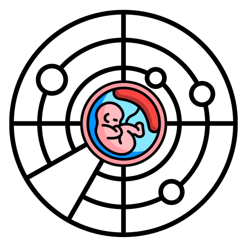

# EmbryoRadar

<!-- badges: start -->
[license]: ./LICENSE
[badge-license]: https://img.shields.io/badge/License-GPLv3-blue.svg

[![License: GPL v3][badge-license]][license]
<!-- badges: end -->



EmbryoRadar is an R package to classify bulk RNA-seq datasets
using the k top-score pairs (kTSP) algorithm trained on
pre-implantation embryo expression datasets.

Additionally, it can compute singscores for scRNA-seq datasets.

## Installation

Install the latest release directly from GitHub using `pak`:

```r
if (!requireNamespace("pak", quietly = TRUE)) {
  install.packages("pak")
}

pak::pak("eckmaslab/EmbryoRadar",
         dependencies = TRUE)
```

## Getting started

You can access a rendered version of the [vignette with example usage cases here][vignette].

## Installation with local vignettes

If you would like to build and access the vignette locally, install the package
from source using `devtools`.

On macOS, first install Pandoc:

```bash
brew install pandoc
```

Then install EmbryoRadar:

```r
if (!requireNamespace("devtools", quietly = TRUE)) {
  install.packages("devtools")
}

devtools::install_github("eckmaslab/EmbryoRadar",
                         build_vignettes = TRUE,
                         dependencies = TRUE)
```

Browse installed vignettes with:

```r
library(EmbryoRadar)
browseVignettes("EmbryoRadar")
```

[vignette]: https://github.com/eckmaslab/EmbryoRadar/blob/main/docs/getting-started.md
