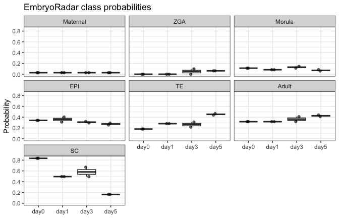
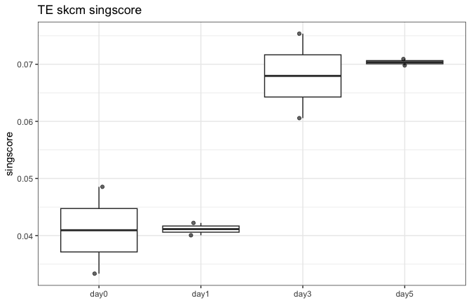

Getting Started with EmbryoRadar
================

Getting Started with EmbryoRadar

This vignette demonstrates the main workflow for using the EmbryoRadar
package:

- Loading a trained multiclass k-TSP model
- Predicting Pre-implantation embryo classes from bulk RNA-seq data
- Computing singscores from TPM matrices
- Visualising predictions

``` r
# ================================
# Full Example Workflow
# ================================

# ---- Load the dataset (ExpressionSet) ----
# this is a Biobase::ExpressionSet object
skcm <- readRDS(system.file("extdata/classifier2.0/GSE232692_exprset.rds",
                            package = "EmbryoRadar"))

skcm
#> ExpressionSet (storageMode: lockedEnvironment)
#> assayData: 321 features, 8 samples 
#>   element names: exprs 
#> protocolData: none
#> phenoData
#>   sampleNames: day0_rep1 day0_rep2 ... day5_rep2 (8 total)
#>   varLabels: iid Status ... Relation_2 (18 total)
#>   varMetadata: labelDescription
#> featureData: none
#> experimentData: use 'experimentData(object)'
#> Annotation:

# Inspect expression and sample features
Biobase::exprs(skcm)[1:3, 1:3]
#>                   day0_rep1   day0_rep2   day1_rep1
#> ENSG00000146038  0.52247683  1.33898510  2.05963956
#> ENSG00000156273 18.32533455 17.23301001 14.76847017
#> ENSG00000115896  0.01451423  0.05463269  0.01462146

# ---- Run the classifier ----
pred <- EmbryoRadar_pred(ExpressionSet = skcm,
                         input_gene_annotations = "ensembl",
                         threshold = "simulation_2.0",
                         model = "trimmed",
                         max_score = FALSE)
head(pred$prediction)
#>             Maternal        ZGA     Morula        TE       EPI     Adult
#> day0_rep1 0.02786308 0.00000000 0.11238476 0.1803271 0.3401315 0.3166057
#> day0_rep2 0.02786308 0.00000000 0.11238476 0.1803271 0.3401315 0.3166057
#> day1_rep1 0.02786308 0.00000000 0.08269503 0.2793331 0.4024617 0.3166057
#> day1_rep2 0.02786308 0.00000000 0.08269503 0.2795988 0.3104947 0.3164038
#> day3_rep1 0.02786308 0.00000000 0.11238476 0.2161144 0.3206012 0.3164038
#> day3_rep2 0.02786308 0.09794585 0.14519239 0.3084280 0.2926962 0.4097516
#>                  SC max_score tie_flag prediction
#> day0_rep1 0.8339269        SC     <NA>        EPI
#> day0_rep2 0.8339269        SC     <NA>        EPI
#> day1_rep1 0.4944882        SC     <NA>        EPI
#> day1_rep2 0.4944882        SC     <NA>        EPI
#> day3_rep1 0.6686660        SC     <NA>        EPI
#> day3_rep2 0.4944882        SC     <NA>     EPI&TE
```

``` r
# ---- Check sample alignment ----
all(pred$prediction$sample == Biobase::sampleNames(skcm))
#> [1] TRUE

# ---- Visualize prediction results ----
plot_df <- pred$prediction |>
  tibble::rownames_to_column("Sample") |>
  separate(Sample, into = c("Day", "Rep"), "_") |>
  pivot_longer(
    cols = c(Maternal, ZGA, Morula, EPI, TE, Adult, SC),
    names_to = "class",
    values_to = "probability"
  ) |>
  mutate(class = factor(class,
                        levels = c("Maternal", "ZGA", "Morula",
                                   "EPI", "TE", "Adult", "SC")))

ggplot(plot_df, aes(x = Day, y = probability)) +
  geom_boxplot(outlier.alpha = 0) +
  geom_jitter(width = 0.1, height = 0, alpha = 0.6) +
  labs(title = "EmbryoRadar class probabilities", x = NULL, y = "Probability") +
  facet_wrap(~class) +
  theme_bw()
```

<!-- -->

The singscore

``` r
# ---- Compute singscores example ----
tpm <- system.file("extdata/classifier2.0/GSE232692_TPM_AllSamples_ver2.csv.gz",
                   package = "EmbryoRadar") |>
  fread()
gid <- gsub("^gene:", "", tpm$gene_id)
tpm <- tpm[, -1:-2]
te_ssc <- compute_TE_singscores(tpm = tpm, ensembl = gid)
#>   |                                                                              |                                                                      |   0%  |                                                                              |=                                                                     |   2%  |                                                                              |==                                                                    |   3%  |                                                                              |===                                                                   |   5%  |                                                                              |====                                                                  |   6%  |                                                                              |=====                                                                 |   8%  |                                                                              |=======                                                               |   9%  |                                                                              |========                                                              |  11%  |                                                                              |=========                                                             |  12%  |                                                                              |==========                                                            |  14%  |                                                                              |===========                                                           |  16%  |                                                                              |============                                                          |  17%  |                                                                              |=============                                                         |  19%  |                                                                              |==============                                                        |  20%  |                                                                              |===============                                                       |  22%  |                                                                              |================                                                      |  23%  |                                                                              |==================                                                    |  25%  |                                                                              |===================                                                   |  27%  |                                                                              |====================                                                  |  28%  |                                                                              |=====================                                                 |  30%  |                                                                              |======================                                                |  31%  |                                                                              |=======================                                               |  33%  |                                                                              |========================                                              |  34%  |                                                                              |=========================                                             |  36%  |                                                                              |==========================                                            |  38%  |                                                                              |===========================                                           |  39%  |                                                                              |============================                                          |  41%  |                                                                              |==============================                                        |  42%  |                                                                              |===============================                                       |  44%  |                                                                              |================================                                      |  45%  |                                                                              |=================================                                     |  47%  |                                                                              |==================================                                    |  48%  |                                                                              |===================================                                   |  50%  |                                                                              |====================================                                  |  52%  |                                                                              |=====================================                                 |  53%  |                                                                              |======================================                                |  55%  |                                                                              |=======================================                               |  56%  |                                                                              |========================================                              |  58%  |                                                                              |==========================================                            |  59%  |                                                                              |===========================================                           |  61%  |                                                                              |============================================                          |  62%  |                                                                              |=============================================                         |  64%  |                                                                              |==============================================                        |  66%  |                                                                              |===============================================                       |  67%  |                                                                              |================================================                      |  69%  |                                                                              |=================================================                     |  70%  |                                                                              |==================================================                    |  72%  |                                                                              |===================================================                   |  73%  |                                                                              |====================================================                  |  75%  |                                                                              |======================================================                |  77%  |                                                                              |=======================================================               |  78%  |                                                                              |========================================================              |  80%  |                                                                              |=========================================================             |  81%  |                                                                              |==========================================================            |  83%  |                                                                              |===========================================================           |  84%  |                                                                              |============================================================          |  86%  |                                                                              |=============================================================         |  88%  |                                                                              |==============================================================        |  89%  |                                                                              |===============================================================       |  91%  |                                                                              |=================================================================     |  92%  |                                                                              |==================================================================    |  94%  |                                                                              |===================================================================   |  95%  |                                                                              |====================================================================  |  97%  |                                                                              |===================================================================== |  98%  |                                                                              |======================================================================| 100%
names(te_ssc)
#> [1] "singscores" "geneSets"
head(te_ssc$singscores[, 1:6, with = FALSE])
#>     sampleID Pozniak_Antigen_presentation
#>       <char>                        <num>
#> 1: day0_rep1                    0.1450363
#> 2: day0_rep2                    0.1417093
#> 3: day1_rep1                    0.1507417
#> 4: day1_rep2                    0.1450550
#> 5: day3_rep1                    0.1432482
#> 6: day3_rep2                    0.1351348
#>    Pozniak_Interferon_alpha_beta_response Pozniak_Melanocytic
#>                                     <num>               <num>
#> 1:                              0.2149849           0.4658856
#> 2:                              0.2119011           0.4679232
#> 3:                              0.2202070           0.4685636
#> 4:                              0.2251413           0.4713923
#> 5:                              0.2150961           0.4741689
#> 6:                              0.2096228           0.4674689
#>    Pozniak_Mesenchymal_like Pozniak_Mitochondriallow_quality
#>                       <num>                            <num>
#> 1:                0.2940090                        0.2553016
#> 2:                0.2966250                        0.2525408
#> 3:                0.3062757                        0.2640660
#> 4:                0.3037465                        0.2472174
#> 5:                0.2850236                        0.2544869
#> 6:                0.2901880                        0.2578786
te_ssc$singscores |>
  separate(sampleID, into = c("Day", "Rep"), "_") |>
  ggplot(aes(x = Day, y = TE_num_tcga)) +
  geom_boxplot(outlier.alpha = 0) +
  geom_jitter(width = 0.1, height = 0, alpha = 0.6) +
  labs(title = "TE skcm singscore", x = NULL, y = "singscore") +
  theme_bw()
```

<!-- -->

``` r
# ---- Reproducibility info ----
sessionInfo()
#> R version 4.5.2 (2025-10-31)
#> Platform: aarch64-apple-darwin24.6.0
#> Running under: macOS Sequoia 15.7.9
#> 
#> Matrix products: default
#> BLAS:   /opt/homebrew/Cellar/openblas/0.3.31_1/lib/libopenblasp-r0.3.31.dylib 
#> LAPACK: /opt/homebrew/Cellar/r/4.5.2_1/lib/R/lib/libRlapack.dylib;  LAPACK version 3.12.1
#> 
#> locale:
#> [1] en_US.UTF-8/en_US.UTF-8/en_US.UTF-8/C/en_US.UTF-8/en_US.UTF-8
#> 
#> time zone: Australia/Melbourne
#> tzcode source: internal
#> 
#> attached base packages:
#> [1] stats     graphics  grDevices utils     datasets  methods   base     
#> 
#> other attached packages:
#>  [1] readxl_1.5.0          singscore_1.28.1      magrittr_2.0.5       
#>  [4] multiclassPairs_0.4.3 data.table_1.18.4     Biobase_2.70.0       
#>  [7] BiocGenerics_0.54.1   generics_0.1.4        lubridate_1.9.5      
#> [10] forcats_1.0.1         stringr_1.6.0         dplyr_1.2.1          
#> [13] purrr_1.2.2           readr_2.2.0           tidyr_1.3.2          
#> [16] tibble_3.3.1          ggplot2_4.0.3         tidyverse_2.0.0      
#> [19] EmbryoRadar_1.0.0    
#> 
#> loaded via a namespace (and not attached):
#>   [1] RColorBrewer_1.1-3          jsonlite_2.0.0             
#>   [3] dunn.test_1.4.1             farver_2.1.2               
#>   [5] rmarkdown_2.31              vctrs_0.7.3                
#>   [7] memoise_2.0.1               scrutiny_0.6.1             
#>   [9] htmltools_0.5.9             S4Arrays_1.10.1            
#>  [11] cellranger_1.1.0            SparseArray_1.10.10        
#>  [13] pROC_1.19.0.1               caret_7.0-1                
#>  [15] parallelly_1.48.0           KernSmooth_2.23-26         
#>  [17] plyr_1.8.9                  cachem_1.1.0               
#>  [19] lifecycle_1.0.5             iterators_1.0.14           
#>  [21] pkgconfig_2.0.3             Matrix_1.7-5               
#>  [23] R6_2.6.1                    fastmap_1.2.0              
#>  [25] GenomeInfoDbData_1.2.14     MatrixGenerics_1.20.0      
#>  [27] future_1.70.0               digest_0.6.39              
#>  [29] AnnotationDbi_1.70.0        S4Vectors_0.48.1           
#>  [31] GenomicRanges_1.62.1        RSQLite_3.53.3             
#>  [33] labeling_0.4.3              timechange_0.4.0           
#>  [35] httr_1.4.8                  abind_1.4-8                
#>  [37] compiler_4.5.2              proxy_0.4-29               
#>  [39] bit64_4.8.2                 withr_3.0.3                
#>  [41] S7_0.2.2                    DBI_1.3.0                  
#>  [43] gplots_3.3.0                R.utils_2.13.0             
#>  [45] MASS_7.3-65                 lava_1.9.2                 
#>  [47] DelayedArray_0.36.1         gtools_3.9.5               
#>  [49] caTools_1.18.3              rdist_0.0.5                
#>  [51] ModelMetrics_1.2.2.2        tools_4.5.2                
#>  [53] ranger_0.18.0               otel_0.2.0                 
#>  [55] future.apply_1.20.2         nnet_7.3-20                
#>  [57] R.oo_1.27.1                 glue_1.8.1                 
#>  [59] nlme_3.1-169                grid_4.5.2                 
#>  [61] reshape2_1.4.5              recipes_1.3.3              
#>  [63] gtable_0.3.6                tzdb_0.5.0                 
#>  [65] R.methodsS3_1.8.2           class_7.3-23               
#>  [67] hms_1.1.4                   XVector_0.50.0             
#>  [69] foreach_1.5.2               pillar_1.11.1              
#>  [71] limma_3.64.3                switchBox_1.44.0           
#>  [73] splines_4.5.2               lattice_0.22-9             
#>  [75] survival_3.8-6              bit_4.6.0                  
#>  [77] annotate_1.86.1             tidyselect_1.2.1           
#>  [79] locfit_1.5-9.12             Biostrings_2.78.0          
#>  [81] knitr_1.51                  IRanges_2.44.0             
#>  [83] Seqinfo_1.0.0               edgeR_4.6.3                
#>  [85] SummarizedExperiment_1.38.1 stats4_4.5.2               
#>  [87] xfun_0.59                   statmod_1.5.2              
#>  [89] hardhat_1.4.3               timeDate_4052.112          
#>  [91] matrixStats_1.5.0           stringi_1.8.7              
#>  [93] UCSC.utils_1.4.0            yaml_2.3.12                
#>  [95] evaluate_1.0.5              codetools_0.2-20           
#>  [97] graph_1.88.1                cli_3.6.6                  
#>  [99] rpart_4.1.27                xtable_1.8-8               
#> [101] Boruta_10.0.0               dichromat_2.0-0.1          
#> [103] Rcpp_1.1.1-1.1              GenomeInfoDb_1.44.3        
#> [105] globals_0.19.1              png_0.1-9                  
#> [107] XML_3.99-0.23               parallel_4.5.2             
#> [109] gower_1.0.2                 blob_1.3.0                 
#> [111] bitops_1.0-9                listenv_1.0.0              
#> [113] GSEABase_1.70.1             ipred_0.9-15               
#> [115] scales_1.4.0                prodlim_2026.03.11         
#> [117] e1071_1.7-17                crayon_1.5.3               
#> [119] rlang_1.2.0                 KEGGREST_1.48.1
```
